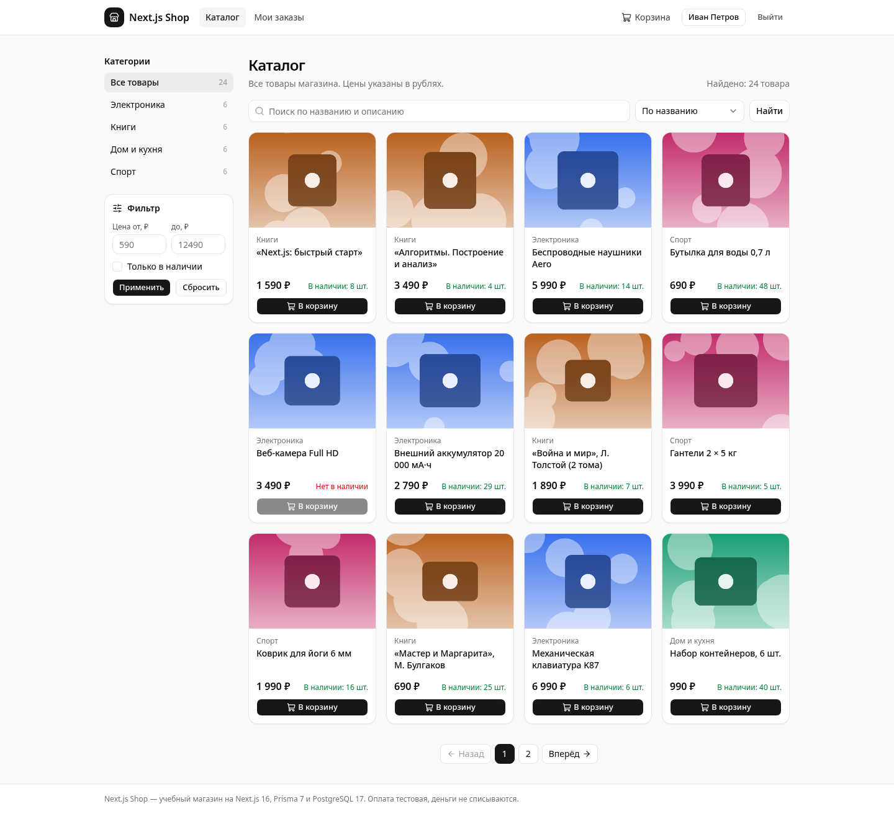
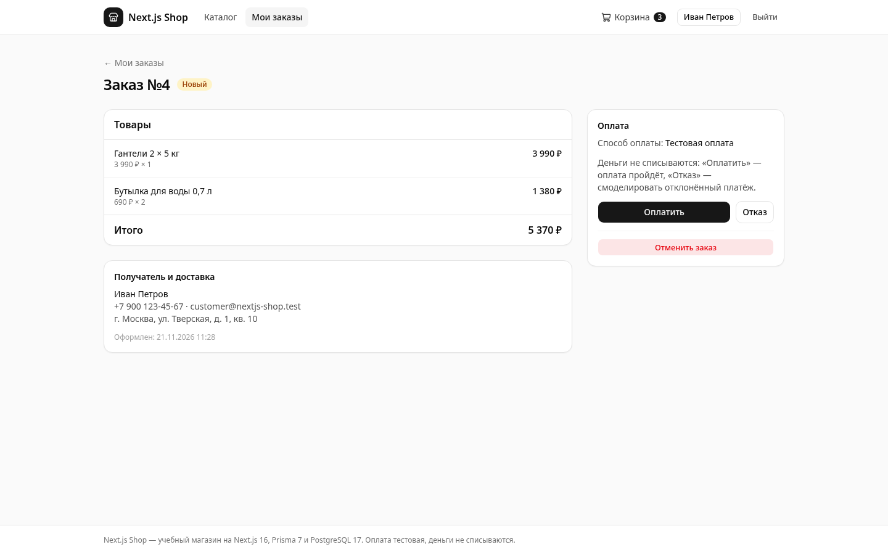
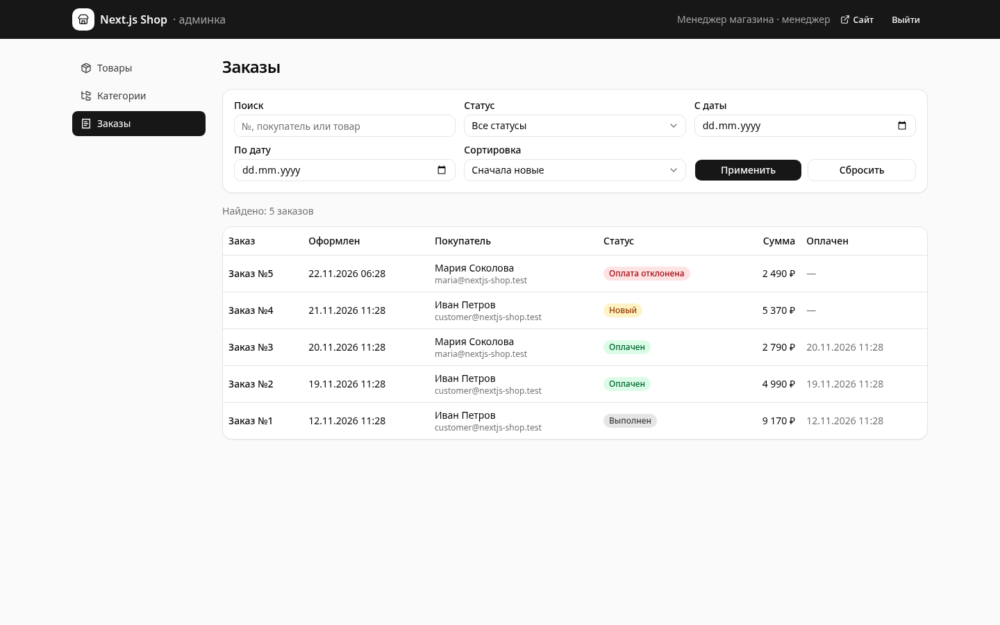

# Next.js Shop

Учебный интернет-магазин на **Next.js 16** (App Router, React Server Components, Server Actions) — тот же
функционал v2, что у [django-shop](https://github.com/dsefremov/django-shop), [laravel-shop](https://github.com/dsefremov/laravel-shop),
[symphony-shop](https://github.com/dsefremov/symphony-shop) и [bitrix-shop](https://github.com/dsefremov/bitrix-shop),
сделанный так, как принято в экосистеме Next.js: серверные компоненты читают данные напрямую через Prisma,
все изменения — Server Actions с проверкой прав в каждом действии, вход — Better Auth, интерфейс — Tailwind CSS 4
и shadcn/ui. База — **PostgreSQL 17**. Цены в рублях, интерфейс на русском. Те же демо-данные, тот же e2e-сценарий
и те же экраны 01–13.

## Что умеет

- **Каталог** — категории, поиск по названию и описанию, фильтры цены и наличия, сортировка (название, цена,
  новизна), 12 товаров на страницу, карточка товара. Фильтры — GET-параметры (`?q=…&price_min=…&price_max=…&in_stock=1&sort=-price`),
  разбираются в `src/lib/filters.ts`; неверные параметры молча отбрасываются, в поиске `%` и `_` ищутся буквально.
- **Корзина** — в БД: у гостя анонимная корзина (её id — в httpOnly-куке `cart_id`), у вошедшего — корзина,
  привязанная к пользователю (переживает выход и другие устройства). При входе и регистрации корзина гостя
  сливается с корзиной покупателя. Количество всегда ограничено остатком.
- **Оформление** — только для вошедших (после входа — обратно на `/checkout`). Одна транзакция Prisma:
  `SELECT … FOR UPDATE` строк товаров в порядке id, проверка и резерв остатка, снимок названия и цены в позициях.
  Два покупателя не купят последний товар одновременно (есть тест на гонку из 5 параллельных заказов).
- **Оплата** — шлюз-заглушка `FakePaymentGateway` (`src/server/payments.ts`, подменяется `setPaymentGateway`).
  «Оплатить» → «Оплачен»; «Отказ» → «Оплата отклонена», резерв сохраняется, можно «Оплатить ещё раз».
  Каждая попытка — запись в истории оплаты (`payment_attempt`), видна покупателю и в админке.
- **Статусы** — «Новый», «Оплачен», «Оплата отклонена», «В работе», «Выполнен», «Отменён»; переходы — по таблице
  `TRANSITIONS` (`src/lib/order-rules.ts`). Отмена возвращает остаток **ровно один раз** (`stockReturnedAt`,
  блокировка строки заказа). Покупатель может отменить неоплаченный заказ.
- **Личный кабинет** — «Мои заказы» (поиск по номеру и товару, статус, даты по Москве, сортировка по дате и сумме,
  пагинация по 10), страница заказа с оплатой и историей, профиль и смена пароля. Чужой заказ — 404.
- **Регистрация и вход** — Better Auth (эл. почта и пароль, сессии в PostgreSQL), выход — Server Action (POST).
  Роль (`customer` / `manager` / `admin`) — дополнительное поле пользователя, которое нельзя передать при регистрации.
- **Админка** — своя, `/admin` (как принято в Next.js — готовой встроенной нет): товары (поиск по названию и адресу,
  фильтры категории, наличия и видимости, сортировка, превью фото, создание, изменение, загрузка фото,
  удаление), категории (удалить категорию с товарами нельзя), заказы (поиск по номеру, покупателю, почте и товару,
  фильтры статуса и дат, позиции и история оплаты), пользователи (только администратор). Доступ — менеджер или
  администратор, покупателю `/admin` отвечает 404. Статус заказа меняется только **действиями** «В работе» /
  «Выполнен» / «Отменить (вернуть остаток)» через ту же бизнес-логику; «Оплачен» вручную не ставится.

## Версии

Все версии зафиксированы точно (`package.json` без `^`/`~`, `package-lock.json`, образы по тегу).

| Что | Версия | Комментарий |
|---|---|---|
| Next.js | **16.4.6** | App Router, Turbopack, `output: "standalone"` |
| React / React DOM | **19.3.1** | Server Components, Server Actions, `useActionState` |
| TypeScript | **5.9.3** | `strict`, `noUncheckedIndexedAccess`, `noImplicitOverride` |
| Node.js | **24.22.1** LTS (`node:24.22.1-bookworm-slim`) | npm 11.21.1 |
| PostgreSQL | **17.12** (`postgres:17`) | в laravel/symphony/bitrix-shop — MySQL 8.4 |
| Prisma | **7.10.1** (`prisma`, `@prisma/client`, `@prisma/adapter-pg`) + pg 8.23.1 | генератор `prisma-client`, `prisma.config.ts`, драйвер-адаптер `pg` |
| Better Auth | **1.7.27** | адаптер Prisma, плагин `nextCookies` |
| Tailwind CSS | **4.3.5** (`@tailwindcss/turbopack`) | |
| shadcn/ui | CLI 4.23.0, стиль `radix-nova`; radix-ui 1.8.1, lucide-react 1.77.0 | компоненты в `src/components/ui` |
| zod | 4.6.7 | валидация форм в Server Actions |
| Тесты | Vitest **5.1.1** (unit + PostgreSQL), Playwright **1.65.0** (Chromium, только локально) | |
| Статпроверки | ESLint 9.39.5 + eslint-config-next 16.4.6, `tsc --noEmit`, `prisma validate`, gitleaks 8.28.0 | |

## Запуск (Docker Compose)

Нужны Docker с Compose v2 и Node 24 (проверки, Vitest и Playwright на хосте). Все сервисы — в `network_mode: host`
и слушают только 127.0.0.1; порты по умолчанию не пересекаются с django-shop (8098 / 8099 / 54317 / 54318):

| Что | Порт | Переменная |
|---|---|---|
| Сайт (standalone-сервер Next.js) | **8108** | `HTTP_PORT` |
| PostgreSQL | **54327** | `DB_PORT` |
| Тестовый PostgreSQL (Vitest, tmpfs) | **54328** | `TEST_DB_PORT` |

```bash
docker/setup.sh          # или DC="sudo -E docker compose" docker/setup.sh
```

Скрипт с нуля: генерирует секреты в `var/` → собирает образы (`next build` — в стадии `build` Dockerfile) →
поднимает PostgreSQL → `prisma migrate deploy` → администратор и демо-данные (`prisma db seed`) → сервер Next.js →
тестовый PostgreSQL → `npm ci` на хосте. Повторный запуск безопасен: секреты не перезаписываются,
миграции идемпотентны, демо-данные загружаются заново (номера заказов снова с 1).

**Паролей в репозитории нет — ни рабочих, ни учебных.** Все они генерируются `docker/secrets.sh` и лежат вне git
(`var/` в `.gitignore`, права 700/600); compose передаёт их контейнерам как secrets (`*_FILE`):

| Что | Файл |
|---|---|
| Пароль PostgreSQL (пользователь `shop`) | `var/secrets/db-password` |
| Пароль тестового PostgreSQL | `var/secrets/test-db-password` |
| `BETTER_AUTH_SECRET` (подпись сессий) | `var/secrets/better-auth-secret` |
| Администратор `admin@nextjs-shop.test` (всё в `/admin`, включая пользователей) | `var/admin-password` |
| Демо-менеджер и демо-покупатели (`manager@`, `customer@`, `maria@nextjs-shop.test`) | `var/demo-users.json` |

Сайт: http://127.0.0.1:8108, админка: http://127.0.0.1:8108/admin.

Для разработки: `npm run dev` (порт 3108) — берёт строку подключения из `DB_*` / `var/secrets/db-password`
и секрет Better Auth из `var/secrets/better-auth-secret` (см. `src/lib/config.ts`), нужен `BETTER_AUTH_URL=http://127.0.0.1:3108`.

Демо-данные (`src/server/demo/demo.ts`, `npm run db:seed`) — те же, что в других магазинах: 4 категории × 6 товаров
(цены, остатки, картинки-заглушки), менеджер, покупатели «Иван Петров» и «Мария Соколова», 5 заказов, оформленных
и оплаченных через ту же бизнес-логику (поэтому у наушников Aero остаток 14 из 15).

## Проверки

```bash
docker/round.sh          # полный раунд: всё ниже по порядку, любой сбой — раунд красный
```

| Проверка | Команда |
|---|---|
| Секретов, `var/` и `.env` нет в git | `docker/check-repo.sh` |
| ESLint, TypeScript, схема Prisma | `npm run lint`, `npm run typecheck`, `npm run prisma:validate` |
| Сборка | `docker compose build web tools` (`next build` внутри образа) или `npm run build` |
| Vitest unit | `npm run test:unit` |
| Vitest на PostgreSQL 17 | `docker compose up -d --wait test-db && npm run test:db` |
| Playwright e2e (покупка, отказ, повторная оплата) | `docker compose run --rm tools npm run db:seed` и `npx playwright test --project=e2e` |
| Скриншоты 01–13 (1440 и 390) | `npx playwright test --project=screenshots` → `docs/screenshots` |

Тесты создают пользователей со случайными паролями; секрет Better Auth в тестах — случайный на каждый прогон.
Тесты БД работают только с базой, имя которой оканчивается на `_test` (иначе прогон останавливается), и перед
прогоном пересоздают схему теми же миграциями. e2e берёт пароли демо-пользователей из `var/demo-users.json`
(или из `E2E_<РОЛЬ>_EMAIL` / `E2E_<РОЛЬ>_PASSWORD`). Что именно запускалось и с каким результатом —
[docs/testing.md](docs/testing.md).

## CI

`.github/workflows/ci.yml` — только на `pull_request`, один job: `docker/check-repo.sh`, gitleaks по всей истории,
`npm ci`, ESLint, TypeScript, `prisma validate`, `next build`, Vitest unit и Vitest на service-контейнере `postgres:17`
(`POSTGRES_HOST_AUTH_METHOD=trust` — пароля нет вообще, `var/` в CI не нужен). Playwright в CI не запускается — только локально.

## Структура

| Что | Где |
|---|---|
| Страницы магазина | `src/app/(shop)/`: `/`, `/catalog/[slug]`, `/products/[slug]`, `/cart`, `/checkout`, `/orders`, `/orders/[id]`, `/login`, `/register`, `/account` |
| Админка | `src/app/admin/`: `products`, `categories`, `orders`, `users` |
| Server Actions | `src/app/actions/`: корзина, оформление и оплата, вход и регистрация, профиль, админка |
| Бизнес-логика и запросы | `src/server/`: `orders.ts` (оформление, оплата, статусы), `cart.ts`, `catalog.ts`, `order-queries.ts`, `admin.ts`, `payments.ts`, `media.ts` |
| Авторизация | `src/server/auth.ts` (Better Auth), `src/server/session.ts` (DAL: `requireUser`, `requireStaff`, `requireAdmin`), `src/app/api/auth/[...all]` |
| Схема и миграции | `prisma/schema.prisma`, `prisma/migrations/` (CHECK-ограничения: цена > 0, остаток ≥ 0 и др.), `prisma/seed.ts` |
| Общие функции | `src/lib/`: фильтры, форматирование (рубли, даты по Москве, склонения), правила статусов, slug, настройки и секреты |
| Интерфейс | `src/components/` (свои компоненты и `ui/` от shadcn), `src/app/globals.css` (Tailwind 4 + тема shadcn) |
| Тесты | `tests/unit`, `tests/db` (Vitest), `e2e/` (Playwright) |
| Стенд | `Dockerfile` (deps / tools / build / runner), `compose.yaml`, `docker/` (`setup.sh`, `round.sh`, `secrets.sh`, `check-repo.sh`) |

## Отличия от django-shop и остальных магазинов

| | laravel-shop / symphony-shop / bitrix-shop | django-shop | nextjs-shop |
|---|---|---|---|
| **СУБД** | MySQL 8.4 | PostgreSQL 17 | **PostgreSQL 17** — поведение и замеры БД с MySQL-магазинами сравнивать с поправкой на это |
| Страницы | Inertia + React, Twig + React, шаблоны + React-острова | Django templates и формы | React Server Components + Server Actions; клиентский JS — только формы с `useActionState`, автоотправка селектов и скрытие сообщений |
| Админка | своя в приложении | штатная `django.contrib.admin` | своя `/admin` на тех же компонентах; доступ — по роли в DAL в каждой странице и каждом действии |
| Вход | свой / фреймворка | `django.contrib.auth` | Better Auth (сессии в PostgreSQL), роль — поле пользователя |
| Блокировка остатка | средствами ORM / ядра | `select_for_update()` | `SELECT … FOR UPDATE` (raw) в `prisma.$transaction`, порядок по id |
| Деньги | целые копейки (symphony) и т. п. | `DecimalField` | целые копейки (`Int`) |
| Корзина гостя | сессия | сессия | строка в БД, id — в httpOnly-куке |
| Сообщения после действий | flash сессии | `django.contrib.messages` | короткоживущая кука `flash`, скрывается при переходе |
| Пароли демо-учёток | таблица в README (laravel, symphony) | только `var/` | только `var/`, в истории git нет ни одного пароля |
| CI | — | статика + pytest на `postgres:17` | статика + `next build` + Vitest на `postgres:17`, без Playwright |

Ещё отличия, которые видны на скриншотах: в книге «…: быстрый старт» стоит «Next.js» (адрес `nextjs-bystryy-start`);
URL «Моих заказов» — `/orders`, входа — `/login`, параметр сортировки — `sort`; сортировка по названию идёт по правилам
сопоставления PostgreSQL (`en_US.utf8`), которые не учитывают кавычки «», — как в django-shop. Поля выбора файла
и даты отрисовывает Chromium, поэтому на скриншотах формы товара подпись «Choose File» и маска «dd.mm.yyyy» —
headless Chromium рисует эти элементы по-английски, несмотря на `locale: "ru-RU"` в Playwright.

## Скриншоты

`docs/screenshots/NN-*-{1440,390}.png`: 01 каталог, 02 товар, 03 корзина, 04 оформление, 05 оплата, 06 мои заказы,
07–09 товары / форма товара / заказы в `/admin` (под демо-менеджером), 10 каталог с фильтрами,
11 заказы с фильтрами, 12–13 списки товаров и заказов админки с поиском и фильтром.

| Каталог | Оплата | Заказы в админке |
|---|---|---|
|  |  |  |
